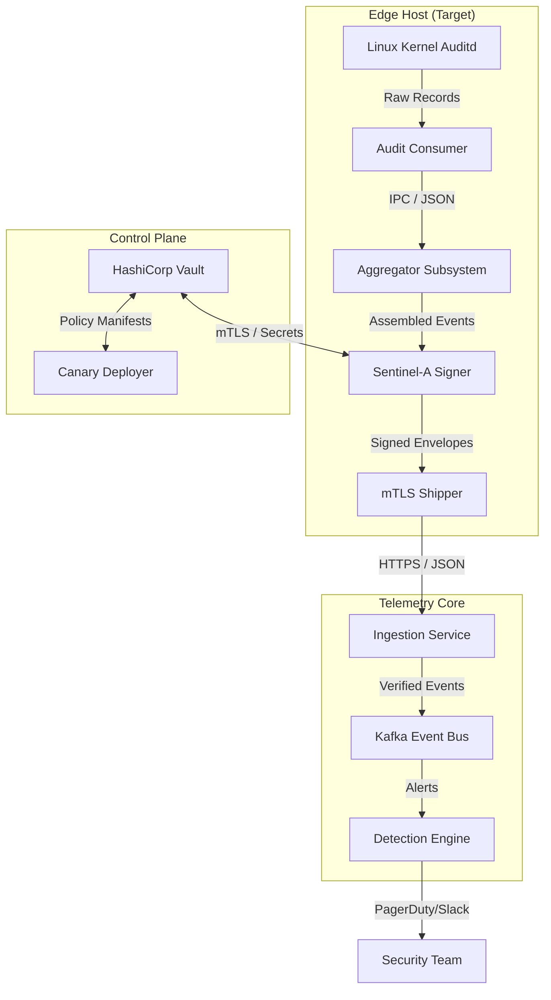

# PROJECT BLUEPRINT: CADOC (Canary-Driven Operational Control)

## 1. Executive Summary
**CADOC** is a high-fidelity, tamper-resistant deception system designed to detect unauthorized access in hardened Linux environments. Unlike traditional logging systems that monitor for "known bad" patterns, CADOC monitors "Canary Assets"—decoys that should never be touched. Any interaction with these assets is a 100% confidence indicator of a security breach.

### Vision
To create an asymmetric cost for attackers: a system that is trivial for administrators to deploy but computationally and operationally expensive for an adversary to bypass without detection.

---

## 2. The Core Problem & Solution

### The Problem: Signal-to-Noise Ratio
Modern security teams are overwhelmed by thousands of "low-confidence" alerts from SIEMs and EDRs. Attackers often hide in this noise (e.g., a legitimate admin running a `cat` command vs. an attacker).

### The Solution: High-Fidelity Deception
CADOC shifts the paradigm to **Deception-Based Security**. By placing "Canary" files (e.g., `/etc/shadow.bak`, `/root/.ssh/id_rsa.old`) in a system, CADOC creates a minefield.
*   **Zero Noise:** No legitimate user or process should ever touch a canary.
*   **Instant Alert:** The moment a canary is read, moved, or modified, a signed alert is shipped.
*   **Cryptographic Integrity:** Every event is signed with Ed25519, preventing attackers from tampering with the logs after a breach.

---

## 3. System Architecture

The system is composed of four primary layers, as mapped by the **Graphify Analysis**:

### A. The Sentinel Layer (Edge)
*   **Sentinel-A (Go):** The primary daemon running on target hosts. It manages the Linux Auditd rules and performs real-time reassembly of kernel records.
*   **Auditmon Subsystem:** A high-performance state machine that reassembles fragmented Auditd records into complete "Audit Events" (Who, What, Where, When).
*   **Zero-Disk Footprint:** Rules are injected into the kernel's memory; no configuration files are stored on disk that an attacker could find and delete.

### B. The Control Plane (Vault)
*   **HashiCorp Vault Integration:** Sentinel-A fetches its identity, signing keys, and canary manifests from Vault.
*   **mTLS Bootstrap:** Uses a "Join Token" and mTLS to establish a secure, authenticated session without hardcoded secrets.

### C. The Ingestion Layer (Transport)
*   **Unified Ingestion Service:** A scalable Go service that receives signed envelopes, verifies the cryptographic signature, and forwards them to a persistent bus (Kafka/PostgreSQL).
*   **Liveness Monitoring:** Tracks "heartbeats" from Sentinels to detect if an attacker has killed the monitoring daemon.

### D. The Response Layer (Detection Engine)
*   **Tier 1 (Instant):** Immediate alerts on canary hits.
*   **Tier 2 (Behavioral):** Uses a **Sliding Window Counter** to detect patterns like "Brute Force" or "Rapid Exfiltration" across multiple hosts.

---

## 4. Technical Deep Dive: The "Auditmon" Subsystem

One of CADOC's core innovations is its handling of the Linux Audit System.

### Record Reassembly Flow
The Linux Kernel sends audit data in fragments. A single `rename` operation looks like this to the kernel:
1.  `SYSCALL` (The actor)
2.  `PATH` (The source file)
3.  `PATH` (The destination file)
4.  `CWD` (The working directory)

**The Aggregator's Role:**
*   **10,000 Tracking Buffers:** CADOC maintains a stateful map of all "puzzles" currently being assembled.
*   **AuditID Correlation:** Fragments are matched using their unique kernel-generated AuditID.
*   **JSON IPC Protocol:** Once a "puzzle" is complete, it is converted to a robust JSON format and sent over a Unix socket for signing.
*   **Shock Absorber:** A 5,000-event queue handles traffic bursts during high-volume system activity.

---

## 5. Security Model: The "Hardened" Design

CADOC is built to survive a "Root-Level" breach.

1.  **Capability Dropping:** After initializing the Auditd subsystem (which requires `CAP_NET_ADMIN`), Sentinel-A drops all unnecessary privileges.
2.  **Tamper-Proof Telemetry:** Alerts are signed *before* they leave the host. An attacker cannot modify the log message once it’s in transit.
3.  **Kill-Switch Protocol:** A cryptographically signed "Kill Switch" ticket can be issued from Vault to gracefully shut down the system for maintenance. Invalid or unauthorized kill attempts trigger a "Self-Harm" alert.
4.  **Hardware-Backing (Roadmap):** Future versions will support TPM 2.0 to store signing keys in hardware, making them un-extractable even for a root user.

---

## 6. Comparison: CADOC vs. Market Alternatives

| Feature | CADOC | Auditbeat | Thinkst Canary |
| :--- | :--- | :--- | :--- |
| **Focus** | Hardened Deception | Compliance Logging | SaaS Deception |
| **Integrity** | Signed Events (Ed25519) | No default signing | Proprietary |
| **Complexity** | Low (Auditd-only) | High (Elastic Stack) | Low (Plug & Play) |
| **Noise** | Near Zero | High (Logs everything) | Zero |
| **Cost** | Open Source / Internal | Paid / Complex | High Subscription |

---

## 7. Operational Roadmap (v1.4+)

*   **Sentinel Hardening:** Implementing graceful shutdown and strict error checking for Vault connectivity.
*   **Policy Engine:** Automated placement of canaries based on the host profile (e.g., "Web Server" gets a different set of canaries than "DB Server").
*   **Multi-Tenancy:** Isolation of telemetry for different departments or clients.
*   **TPM 2.0:** Moving signing keys from memory to hardware.

---

## 8. Architecture Diagram (Mermaid)

